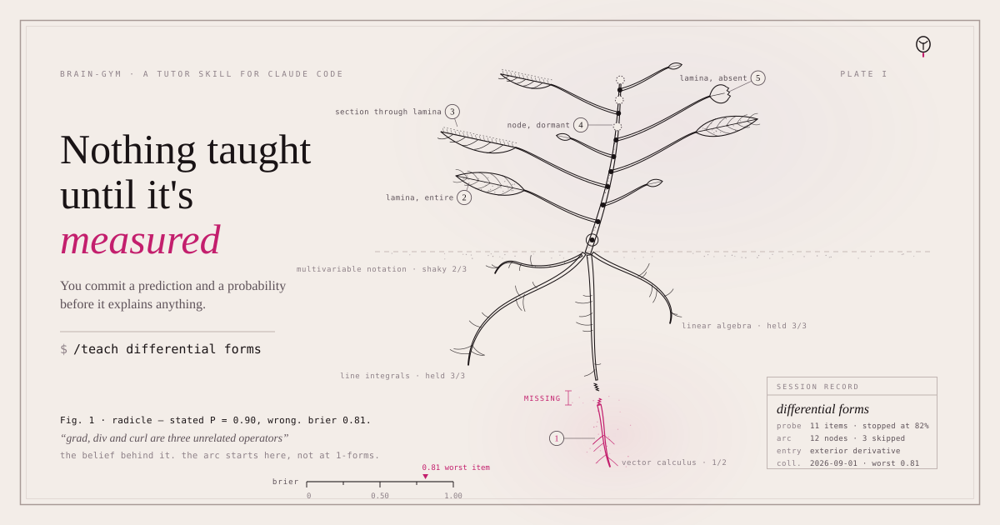
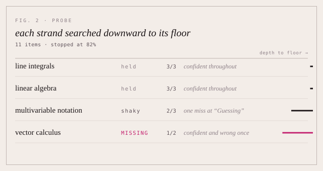
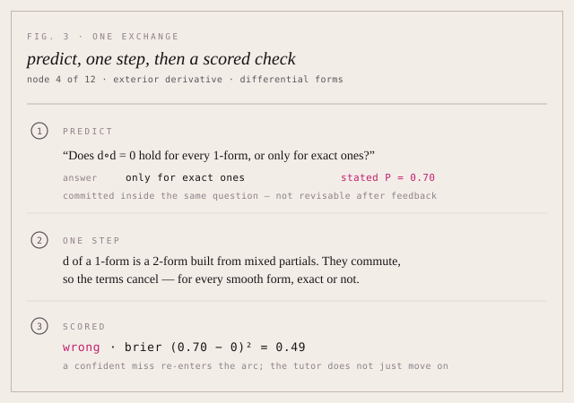
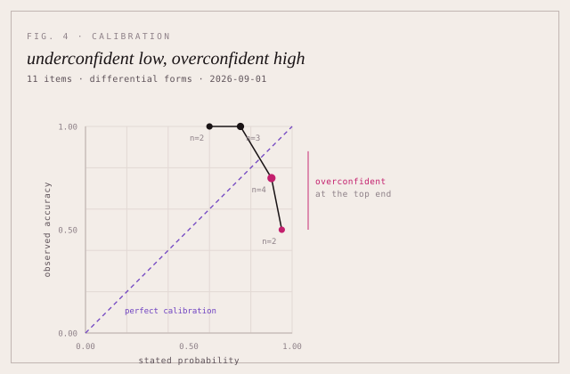

<div align="center">



<h1>brain-gym</h1>

<p><b>A tutor that measures what you already know before it teaches you anything.</b><br>
A skill for <a href="https://www.claude.com/claude-code">Claude Code</a>. Any subject.<br>
The atomic unit isn't "an explanation" — it's a <b>prediction you commit before the answer exists</b>.</p>

[](skills/teach/PROTOCOL.md)
[](#install--about-one-minute)


</div>

---

## Why this exists

Most AI tutoring is a lecture you nod along to. You ask, you get a well-written explanation, you feel like you understood it, and a week later you cannot reproduce any of it.

The feeling is the problem. Subjective fluency is a [measurably misleading proxy](EVIDENCE.md#pr_fluency_poor_transfer_proxy) for whether anything was learned, and the conditions that feel hardest frequently produce the best retention. So this tutor is built to refuse the four things that make AI teaching feel good and work badly:

|  | It never... |
|:--:|---|
| **r.01** | **Leads with the answer.** Ask "what is a covector?" and it asks what you expect first, with a probability. Every time. |
| **r.02** | **Accepts "that makes sense."** The only evidence a concept landed is a scored item. "I've got it" is a prediction, and it gets graded. |
| **r.03** | **Covers two ideas in one message.** One reasoning step, ending at a decision point rather than a summary. |
| **r.04** | **Reports one pooled score.** Calibration [transfers across some domains and fails completely on others](EVIDENCE.md#ctd_calibration_generalizes_partially), so it is read per subject. |

You do the cognitive work. It does the measuring, the sequencing, and the bookkeeping.

> Every rule it follows traces to a citation in [`EVIDENCE.md`](EVIDENCE.md). When a rule feels wrong in the moment, that file is where to go and argue with it — not the vibe of the session.

---

## Watch it find your edge

Before teaching anything, it decomposes your topic into dependency strands and binary-searches each one. Ask for `/teach differential forms` and the probe ends somewhere like this:

<div align="center">

</div>

The worst item is the one worth reading:

> **stated P = 0.90, wrong — brier 0.81**
> *"grad, div and curl are three unrelated operators"*
>
> The belief behind it: an operator is defined by its formula, not by what it does to a field. That belief is where the arc has to start — so the entry point moves to the exterior derivative, not 1-forms, and 3 of the 12 nodes are skipped as already held.

A confident wrong answer is the most informative result available, so the tutor hunts for them — and the arc starts at the belief that produced one, not at chapter one.

---

## What one exchange looks like

Teaching walks the arc one node per message. Every node has the same three beats, and the third is the one most AI tutors skip:

<div align="center">

</div>

The probability is committed inside the same question as the answer, so it cannot be revised once feedback lands. That is what makes the score mean anything — and why a miss at `P = 0.70` costs `0.49` rather than being waved through as "close enough."

---

## What you get

| | |
|---|---|
| **`[protocol]`** | **The 11 rules**, each traced to the claim behind it. Predict-then-check, the 85% difficulty band, similarities-before-differences, spacing intervals, what the tutor never does. |
| **`[skill]`** | **The tutor** — three phases, the confidence-scored quiz format, production tasks for generative material, and the session-closing diagnosis. |
| **`[evidence]`** | **The claims the rules rest on**, with real sources, confidence levels and verification dates. Including two null results that explain what the protocol deliberately *doesn't* do. |
| **`[agent]`** | **A `fact-check` subagent** that verifies load-bearing claims before they get taught — and returns `unverifiable` rather than inventing a citation. |

**You bring the curiosity. The protocol stops the tutor from being pleasant instead of useful.**

> [!IMPORTANT]
> **This will feel worse than being explained to.** Slower, more effortful, and more exposing — you will be wrong out loud, on the record, with a number attached. That is the design, not a rough edge: the methods that feel most effective are [reliably not the ones that work](EVIDENCE.md#pr_interleaving_and_spacing). If you want a quick answer, ask a quick question. Don't invoke `/teach` and then get annoyed that it won't just tell you.

---

## Requirements

- **Claude Code, in an interactive session.** `AskUserQuestion` — what the probe and every quiz item run on — does not exist in `-p`/headless mode.
- **bash and git**, for `install.sh`.
- **Optional:** the official Obsidian CLI (ships with Obsidian 1.12+), only if you want the [Obsidian backend](skills/teach/STORAGE.md) instead of plain files.

---

## Install · about one minute

### 1 · Clone it

```bash
git clone https://github.com/christian93kg/brain-gym.git ~/brain-gym
```

### 2 · Link it in

```bash
cd ~/brain-gym && bash install.sh
```

This symlinks `skills/teach` and `agents/fact-check.md` into `~/.claude`, so a later `git pull` updates them in place. Use `--force` to move anything already there aside as `<name>.bak.<timestamp>` (nothing is deleted), `--uninstall` to remove the symlinks again.

Or install it as a plugin instead:

```bash
claude plugin marketplace add christian93kg/brain-gym
claude plugin install brain-gym@brain-gym
```

The skill is then `/brain-gym:teach` — bare `/teach` also works as long as it's unambiguous.

### 3 · Start

```
/teach the Monty Hall problem
```

| Command | What it does |
|---|---|
| `/teach <topic>` | Start a new session |
| `/teach <topic> -- I already know X, Y` | Seed the probe so it runs shorter |
| `/teach` | Resume the most recent unfinished session |
| `/teach --due` | Run the spaced reviews that have come due |
| `/teach --status` | Print the session index without starting anything |

> [!WARNING]
> **Run this on the strongest model you have.** Teaching quality tracks model intelligence far more than it tracks anything written in `SKILL.md`. On a small model the tutor will follow the letter of the protocol and still teach badly — it is instructed to tell you when that is happening. The `fact-check` subagent inherits the same model, so there's no separate lever for verification quality.

---

## How it works

<table>
<tr align="center">
<td width="25%"><br><b>Probe</b></td>
<td width="25%"><br><b>Plan</b></td>
<td width="25%"><br><b>Teach</b></td>
<td width="25%"><br><b>Revisit</b></td>
</tr>
<tr valign="top">
<td>20 items max, or stop at 85% accuracy — whichever comes first</td>
<td>A mermaid DAG of the whole arc, fact-checked if the topic is empirical</td>
<td>One node per message, each closed by a scored item — never "does that make sense?"</td>
<td>Spaced at 10–20% of the intended retention interval</td>
</tr>
</table>

Each phase refuses to start before the one above it has produced something measured. The probe caps at 20 items and announces why it stopped. The plan is emitted as a mermaid DAG into your session note, so the reasoning happens up front instead of being winged mid-explanation. Teaching walks that graph one node per message, tuning against the [85% accuracy band](EVIDENCE.md#ctd_85_percent_optimal_error_rate) — harder above ~95%, back up to prerequisites below ~70%.

What accumulates across a session is a calibration curve, read per subject rather than pooled:

<div align="center">

</div>

The interesting half is the right-hand end. Being underconfident about what you already know costs little; being 90% sure and wrong is what the arc gets built around.

<details>
<summary><b>What each phase actually does</b></summary>

<br>

- **Probe** — Decompose the topic into dependency strands, then binary-search each: right and confident, go deeper; wrong or right-while-guessing, go shallower to find the floor. Prior sessions in an adjacent subject count as free probe data. Stops near 85% accuracy or at 20 items, whichever comes first.
- **Plan** — Reason the whole arc out, one node per concept, each naming its prerequisites, and mark the nodes the probe showed you already hold. For empirical topics — history, medicine, nutrition, current practice — the `fact-check` agent verifies the load-bearing claims first. It is deliberately skipped for self-verifying formal material like mathematics, where it produces citation theatre rather than verification.
- **Teach** — Per node: predict, then one reasoning step, then a real scored check. Item types are [interleaved rather than blocked](EVIDENCE.md#pr_interleaving_and_spacing). Analogies run similarities-first in a [four-step order](EVIDENCE.md#ctd_comparison_design_moderators) where reversing the sequence measurably costs you.
- **Revisit** — Every finished session sets a `revisit_on` date at [10–20% of the intended retention interval](EVIDENCE.md#ctd_spacing_is_the_scheduling_lever). `/teach --due` re-quizzes what has come due, interleaved across subjects.

Confidence is committed on a four-point scale — 30% / 50% / 70% / 90% — inside the same question as the answer, so you cannot revise it after seeing feedback. Everything is scored with the Brier rule, `(P − outcome)²`.

</details>

---

## Your data stays yours

Sessions land in `learn/` and scored items in `log/`, under whatever directory you run from (or `$TEACH_HOME`). Starting shapes for both are in [`skills/teach/templates/`](skills/teach/templates/).

> [!NOTE]
> **Both directories are gitignored here by default.** Cloning or forking this repo will not publish your scores. If you want your own history versioned, use a **private** fork and remove those lines from `.gitignore` — decide before your first commit, because git history is permanent.

**Run `/teach` with `$TEACH_HOME` pointed outside any repository you push** — the tutor now checks, before its first write, whether the working directory is inside a git work tree with `learn/` and `log/` left un-ignored, and stops to ask rather than silently staging your sessions and scores into that repo.

Running inside an Obsidian vault, or want a different backend? See [`skills/teach/STORAGE.md`](skills/teach/STORAGE.md) — it uses Obsidian's official CLI, not the third-party `obsidian-cli` tool.

---

## Limitations

Stated plainly, because a tool about calibration should be calibrated about itself.

- **This came out of an n=1 personal system.** It was built for one person's training block and generalized outward. There is no trial showing this tutor beats any other tutor. What there is evidence for is each individual rule.
- **The claims are research summaries, not a systematic review.** Several are `medium` confidence and say so — including the 85% band, whose evidence tier is computational models rather than a human learning RCT. Read the confidence field before treating one as settled.
- **The Brier scores have a floor.** A four-option item can be answered correctly by chance ~25% of the time, so these numbers are not on the same scale as free-form forecasting and should not be pooled with it.
- **The tutor is slow on purpose.** See the note above. This is the most common reason people bounce off it.

---

## Repo layout

```
.claude-plugin/             plugin.json + marketplace.json — the plugin manifest
skills/teach/SKILL.md       the tutor: phases, quiz format, session mechanics
skills/teach/PROTOCOL.md    the 11 rules, each with the claim behind it
skills/teach/STORAGE.md     persistence backends — plain files, or Obsidian
skills/teach/templates/     starting learn/index.md, teach-log.md, teach-config.md
agents/fact-check.md        verifier subagent for empirical topics
EVIDENCE.md                 the claims the rules rest on, with sources
DEEP-RESEARCH-PROMPTS.md    the prompt shape EVIDENCE.md's research passes used
install.sh                  symlinks the skill and agent into ~/.claude
.github/workflows/ci.yml    syntax, shellcheck, manifest and ignore-rule checks
docs/                       Plate I (plate-i.svg), Fig. 2 probe, Fig. 3 exchange,
                            Fig. 4 calibration, four phase glyphs, the mark —
                            each with a -dark.svg counterpart
CONTRIBUTING.md             how to propose a change, and the house style
```

`PROTOCOL.md` is the interesting file. If you read one thing, read that.

---

## Credits & license

- **Sibling project** — [second-brain](https://github.com/christian93kg/second-brain), an Obsidian + Claude Code knowledge base. `EVIDENCE.md` follows its claim format: assertion, source, confidence, verification date.
- **Evidence** — see [`EVIDENCE.md`](EVIDENCE.md) for per-claim sources; the load-bearing ones are Wilson et al. 2019, Cepeda et al. 2006, Alfieri et al. 2013, Gick & Holyoak 1980, Dunlosky et al. 2013
- **Method** — the research passes behind `EVIDENCE.md` were commissioned with the prompt shape in [`DEEP-RESEARCH-PROMPTS.md`](DEEP-RESEARCH-PROMPTS.md).
- **License** — MIT, see [`LICENSE`](LICENSE)

<div align="center">
<br>

**[Read the protocol →](skills/teach/PROTOCOL.md)** · **[See the evidence →](EVIDENCE.md)**

</div>
